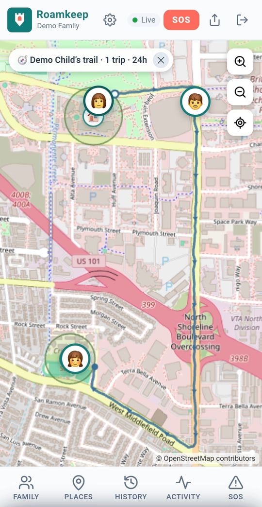
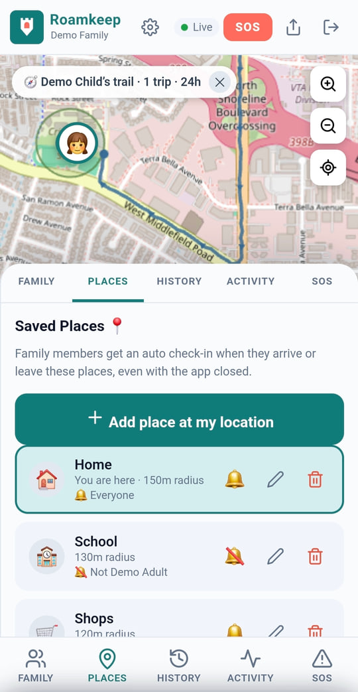
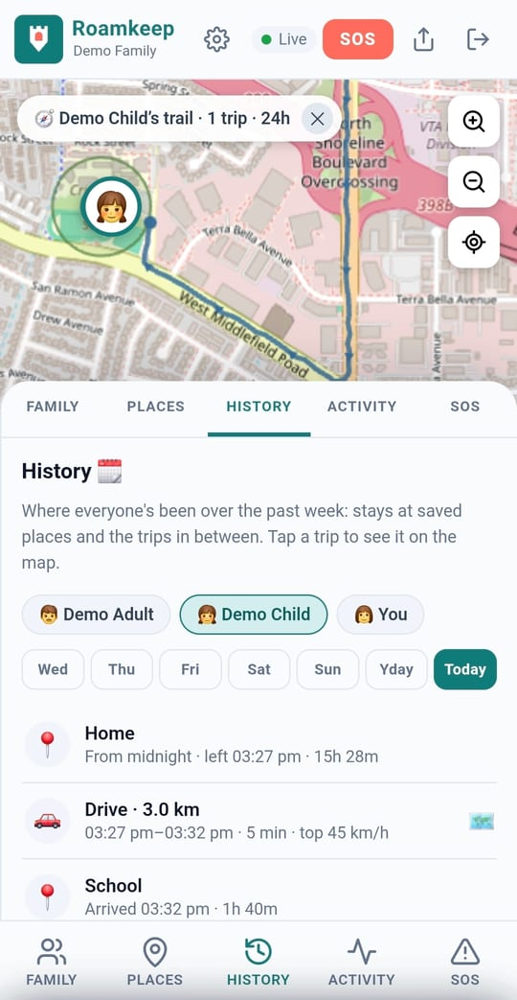

# Roamkeep

**Private family location sharing, on a database your family owns.**

[roamkeep.app](https://roamkeep.app) ·
[Google Play](https://play.google.com/store/apps/details?id=com.roamkeep.app) ·
[Get started](https://roamkeep.app/get-started/) ·
[What's new](CHANGELOG.md)

A live family map, saved places with arrive and leave alerts, a week of
history that deletes itself, and SOS. Under the hood: a vanilla-JS PWA,
wrapped in a Capacitor Android shell, backed by Supabase, with native OS
geofencing and content-free push notifications.

**Android only.** Everyone who shares their location needs an Android phone;
there is no iPhone app.

Every family runs their **own** backend. The app is pointed at a family's own
Supabase project at first run, and the author operates no server that holds a
family's data. The one author-run component, a push relay, sees only opaque
device tokens and timing, never names, places, or coordinates. The source is
published so those claims can be checked.

## Screenshots

<!--
  Plain phone captures, downscaled to 540px — deliberately NOT the
  letterboxed 9:16 variants that `node tools/store-assets.js` writes into
  the gitignored store/ dir for Play.

  Every one is from the demo backend: invented people, invented places,
  synthetic trails. No real family appears in this repository.
-->

| Map & live pins | Places & geofences | History timeline |
|---|---|---|
|  |  |  |

## What you need

- An Android phone for everyone who shares their location.
- A free [Supabase](https://supabase.com) account, for the person who sets it
  up. Supabase runs the family's database on their own account.
- About five minutes on that person's phone.

## Get started

Install **Roamkeep** from
[Google Play](https://play.google.com/store/apps/details?id=com.roamkeep.app),
open it and tap **Set up a new family**. The app creates the family's Supabase
project, installs the schema and both Edge Functions, and connects you as the
first owner. You never build the app. Everyone else joins from an invite
shared inside the app, and an owner approves them.
[roamkeep.app/get-started](https://roamkeep.app/get-started/) walks through
it.

Prefer a computer? The desktop wizard does the same job and prints a setup
link and QR code at the end:

```bash
cd cli && npm start
```

The long version, including the Windows-specific traps, is in
**[docs/OWNER_SETUP.md](docs/OWNER_SETUP.md)**.

## Consent and safeguards

Roamkeep is for families who agree to share with each other, and it is built
so that it can't quietly become anything else:

- Everyone in a Keep sees everyone else. There are no one-way watchers.
- A notification is on screen whenever location is being recorded, and it is
  posted again if it's swiped away.
- Adults can pause their own sharing for a while. Children can't, and can't
  leave or delete their own account, but anyone can disconnect their phone,
  and the family sees that they did.
- If an owner changes what someone can do, that person is told.
- New members wait for an owner to approve them, so a forwarded invite is a
  request rather than a way in.
- The terms forbid using Roamkeep to track anyone without their knowledge.

Each of these is enforced by the database or the native code, not only the
screen.

## How it works

The same web bundle runs two ways: as a PWA served as static files, and
wrapped in a Capacitor Android shell that adds OS-level geofencing, a
background-location foreground service, and push. Supabase is the shared
backend: Postgres, row-level security, realtime, auth, and two Edge
Functions. There is no custom server.

**[docs/ARCHITECTURE.md](docs/ARCHITECTURE.md)** is the long version,
including the parts that are non-obvious: why push is content-free, how
native geofence state is kept in step with the database, and which failures
are silent by nature.

## How Roamkeep is built

<!-- DRAFT for the owner's sign-off (plan C5). Never name the tool or vendor. -->
Roamkeep is designed and run by one person, David Carabetta, who made every
product and privacy decision and tests it on real phones. Much of the code
was written with an AI coding assistant, working under his direction and
review. It has been tested by 12 people over several months; the bugs those
tests found, and why each fix is the way it is, are written up in the code,
and the design that came out of them in
[docs/ARCHITECTURE.md](docs/ARCHITECTURE.md).
[roamkeep.app/security](https://roamkeep.app/security/) says what has and
hasn't been independently reviewed.

## Contributing

Small and specific is best. [CONTRIBUTING.md](CONTRIBUTING.md) covers the
conventions and the contributor terms. The latter exist so that every
version can still convert to Apache 2.0 on its Change Date.

## Security

Please report vulnerabilities privately. See
**[SECURITY.md](SECURITY.md)**, which also lists the things that look like
vulnerabilities and are not (the anon key is public by design; row-level
security is the boundary).

## License: source-available, not open source

Roamkeep is released under the **Business Source License 1.1 (BSL 1.1)**. See
[`LICENSE`](LICENSE) for the full text and parameters.

**BSL is not an OSI "open source" license, and we don't call it one.** It is
*source-available*: the complete source is public and auditable, but some
commercial rights are reserved for a time. We chose it deliberately, and the
distinction matters, so here is the reasoning in full.

- **The privacy claims are the product, and they are only credible if you can
  read the code.** Roamkeep's whole premise is that each family holds their own
  data and the author can't see it. A closed binary asking you to trust that is
  not good enough. Publishing the source lets anyone verify what the app sends,
  where it sends it, and what the relay does and doesn't retain.

- **Source-available gets us that auditability without giving away the right to
  compete commercially.** Under the BSL you may read, modify, build, and
  self-host Roamkeep for your **own family's personal, non-commercial use**.
  That's the [Additional Use Grant](LICENSE), and it's granted freely. What the
  license withholds is the right to take this code and offer it to third parties
  as a paid or competing hosted service. That reservation is why this is BSL and
  not AGPL: it stops anyone turning your family's app into a paid hosted
  service, while keeping everything else open.

- **It doesn't stay restricted forever.** The BSL has a built-in expiry.
  Every version converts automatically to the **Apache License 2.0**, a
  permissive open-source license, on the **Change Date** in
  [`LICENSE`](LICENSE) (17 August 2030), or four years after that version was
  first published if that comes sooner. The restriction is a head start, not
  a permanent enclosure.

- **The word choice is deliberate.** "Open source" has a specific meaning (the
  OSI definition) that the BSL does not meet, and misusing the term invites an
  argument that adds nothing. We say **source-available**. If that distinction
  matters to you, it should, and now you know exactly where Roamkeep sits.

Third-party components ship under their own licences. See
[NOTICE.md](NOTICE.md), which is generated from the packages actually
installed rather than maintained by hand.

The author retains copyright, so separate commercial licensing terms are
available on request. See the contact in [`LICENSE`](LICENSE).

### Trade marks

**Roamkeep** and the keep logo are trade marks of David Carabetta. The
licence grants no rights in them; see [`LICENSE`](LICENSE).

## Support development

Roamkeep is free, has no paid features, and runs no author-operated tier. The
model is deliberately **self-host plus donations**. If it's useful to your
family and you'd like to help cover the cost of the one shared piece (the push
relay) and continued development, you can chip in on
[**Ko-fi**](https://ko-fi.com/roamkeep).
[roamkeep.app/support](https://roamkeep.app/support/) shows what it takes to
run and where the money goes.

Donations support development only; they don't unlock features (there aren't
any to unlock) and confer no commercial license. See the section above for
that.
